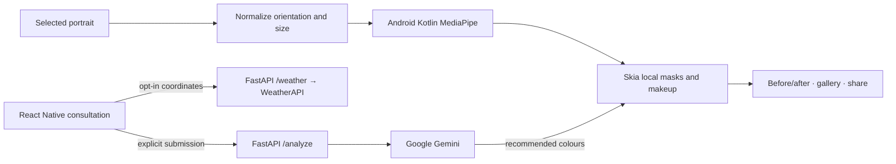

# GlowAI for Android

An Android beauty consultation and local photo makeup studio based on [mxtrshayan/glow-ai](https://github.com/mxtrshayan/glow-ai). The original site is preserved in `reference-web/`; the FastAPI routes, recommendation prompts, curated fallback and Python makeup engine are reused in `backend/`.



## Workspace

- `mobile/`: strict TypeScript, Expo development build, React Navigation, shared design system and feature code.
- `mobile/modules/glow-face/`: local Expo Kotlin module and bundled Face Landmarker model. Survives `expo prebuild --clean`.
- `backend/`: FastAPI `/analyze`, `/weather`, `/tryon`, `/health`; no credentials in mobile.
- `reference-web/`: unmodified upstream clone.
- `docs/`: requirements, privacy, phase verification and current implementation status.

## Software

Built with Node 26.8.2, npm 11.19.1, Expo SDK 57, React Native 0.86.3, TypeScript 6, JDK 17 (Zulu), Python 3.13, Android SDK 36 and NDK 27.1.12297006. Use Android Studio with SDK platform/build tools 36, platform-tools and an API 35+ emulator. Local Android package: `com.glowai.app`. Use a development build, not Expo Go.

## Backend

```sh
cd "$HOME/Desktop/Glow-Ai App/backend"
python3.13 -m venv .venv
source .venv/bin/activate
pip install -r requirements-dev.txt
cp .env.example .env
# Edit .env privately with your own keys.
python -m uvicorn api.index:app --host 0.0.0.0 --port 8080 --reload
```

Environment values:

| Variable | Location | Purpose |
| --- | --- | --- |
| `GEMINI_API_KEY` | backend/.env | Personalised AI analysis |
| `GEMINI_MODEL` | backend/.env | Default `gemini-flash-latest` |
| `WEATHER_API_KEY` | backend/.env | Optional WeatherAPI.com weather |
| `EXPO_PUBLIC_API_BASE_URL` | mobile/.env | Public backend URL only |

No keys supplied: backend returns the original curated fallback, explicitly labelled in the app. This is not a successful Gemini analysis. Weather may be skipped. Studio needs neither key nor internet.

## Android development

```sh
cd "$HOME/Desktop/Glow-Ai App/mobile"
npm install
cp .env.example .env
export ANDROID_HOME="$HOME/Library/Android/sdk"
export PATH="$ANDROID_HOME/platform-tools:$ANDROID_HOME/emulator:$PATH"
npx expo prebuild --platform android
npx expo run:android --port 8082
```

The scripts `npm start` and `npm run android` use port 8082 to avoid another local project on 8081. Gradle may download the matching NDK/build tools on the first build. Set `JAVA_HOME` to a JDK 17 installation if your shell uses another JDK.

For Android emulator, `http://10.0.2.2:8080` reaches the Mac's localhost. `localhost` inside Android points to Android itself. For a physical device, set `EXPO_PUBLIC_API_BASE_URL=http://YOUR_MAC_LAN_IP:8080`, connect phone and Mac to the same Wi-Fi, allow the backend through the Mac firewall, and run `npx expo run:android --device --port 8082`. Restart Metro after environment changes. Alternatively use `adb reverse tcp:8080 tcp:8080` and a localhost API URL for a USB-connected phone. Use HTTPS for a deployed backend.

## APK and AAB

```sh
cd "$HOME/Desktop/Glow-Ai App/mobile/android"
./gradlew assembleDebug
# Output: app/build/outputs/apk/debug/app-debug.apk (requires Metro)
./gradlew assembleRelease
# Output: app/build/outputs/apk/release/app-release.apk
./gradlew bundleRelease
# Output: app/build/outputs/bundle/release/app-release.aab
```

The generated template uses a development signing key. Configure your own secure upload keystore or EAS credentials before Play distribution. Never commit a production signing key. See implementation status for artifacts actually built and tested; commands above do not imply every artifact has been generated.

## Checks

```sh
cd "$HOME/Desktop/Glow-Ai App/mobile"
npm run typecheck
npm run lint
npm test
npx expo-doctor
cd ../backend
.venv/bin/python -m pytest -q
```

## Privacy and behaviour

Portrait upload happens only on consultation submission. Studio uses face geometry on the device, never biometric identity. The backend processes portraits in memory. Provider policies apply to Gemini/WeatherAPI requests. Current looks are session-only; sensitive photo/profile state is not persisted in AsyncStorage. Save explicitly exports a copy to the gallery. Temporary app portraits are removed on replacement/removal and next launch. See `docs/privacy-notes.md`.

## Troubleshooting

- Backend unreachable: open `http://localhost:8080/health` on the Mac, check emulator vs LAN host, and restart Metro after editing `.env`.
- Native module missing: rebuild using `expo run:android`; Expo Go does not include GlowFace.
- No face/multiple faces: choose one clear, front-facing portrait in natural light.
- Permissions denied: choose gallery instead of camera, skip weather, or enable permissions in Android Settings.
- SDK not found: set `ANDROID_HOME` or write `sdk.dir=/absolute/path/to/Android/sdk` in ignored `mobile/android/local.properties`.
- Backend native crash on macOS: use the pinned MediaPipe 0.10.32; 1.0.1 failed in its Metal service initialization here.
- Space-containing workspace: quote all paths. The package name and Android application ID never derive from the folder name.

## Technical references

[MediaPipe Android Face Landmarker](https://developers.google.com/edge/mediapipe/solutions/vision/face_landmarker/android), [Expo SDK reference](https://docs.expo.dev/versions/latest/), [Google Gen AI SDK](https://googleapis.github.io/python-genai/). Installed package lockfiles and checked native APIs determine the implementation versions.
